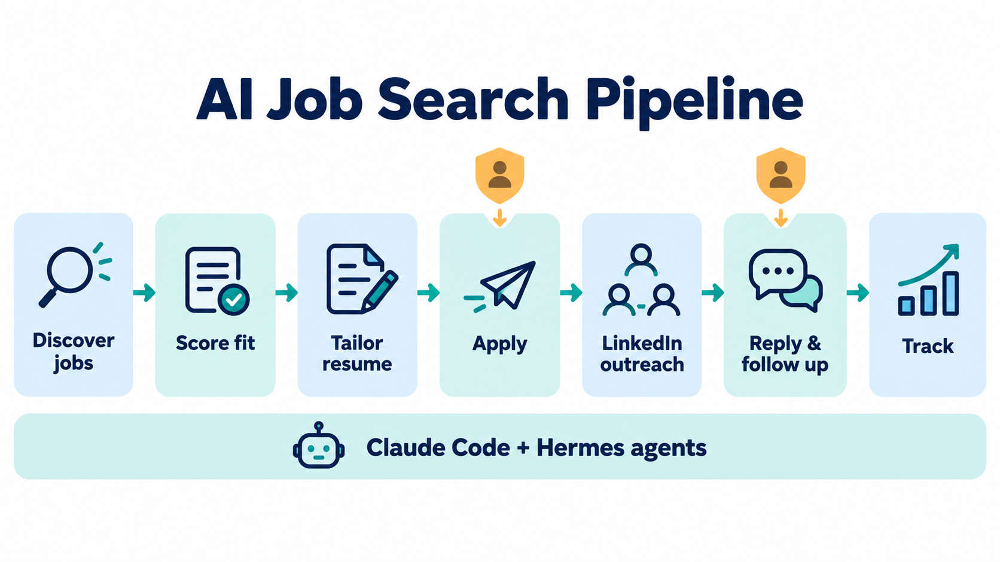
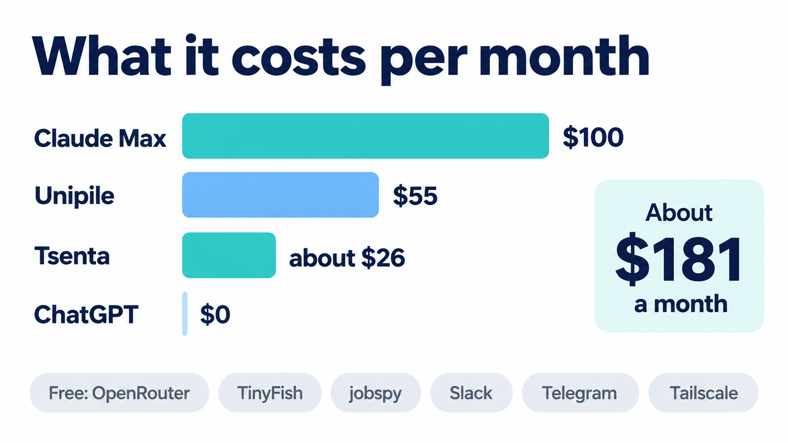

# AI Job Search Workflow (Claude Code + Hermes)

A working, mostly automated job search for AI/ML engineering roles. It runs every day across a Windows workstation and a small Linux home server. It finds fresh postings, scores each one against the full job description, applies only to strong fits with a tailored resume, invites the right recruiters on LinkedIn, drafts replies, and keeps a tracker and a dashboard up to date. You approve the edge cases from your phone.

This repo is the real setup, cleaned of personal data. Every skill, prompt, cron job, systemd unit and script here is a copy of what actually runs, with names, emails, IDs and keys replaced by placeholders like `<YOUR_NAME>` and `<UNIPILE_API_KEY>`. The small details (caps, retry rules, schedules, failure fixes) are left in on purpose, because they took the longest to get right.

## What runs, and when

| When (server time) | What | Where | Human step |
|---|---|---|---|
| 03:30 and 04:20 | Hermes self-update, then a gateway restart | Home server | none |
| 06:00, 11:00, 18:00 | Tsenta apply runs (fill the day's target) | Home server | Approve applications Tsenta parks for review |
| 09:37, Mon to Fri | Warm invites to hiring-team members of open roles | Home server | none (capped at 8 a day) |
| 11:00 | Recruiter scout (Hermes cron, Claude) | Home server | Approve any recruiter email in Slack |
| 22:00 | Nightly apply run plus outreach for confirmed applications | Home server | Same as above |
| Every 5 min | LinkedIn inbox check: new accepts and replies, drafts answers | Home server | Approve, edit or skip held replies in Telegram |
| On demand | Tailored resume, application answers, job scraping | Workstation (Claude Code) | You run them |

## Start here

1. **[How it works](docs/how-it-works.md):** the full daily flow, the rules every agent follows, and the LinkedIn safety budget.
2. **[Setup guide](docs/setup.md):** step by step, from accounts to timers, with a check after each step.
3. **[Any agent, any system](docs/any-agent.md):** run it with Codex, OpenCode, Gemini, Cursor, ChatGPT or n8n instead of Claude Code and Hermes. Includes cron, macOS launchd, Windows Task Scheduler and Docker.
4. **[Notifications](docs/notifications.md):** every message the workflow sends, and how to receive it on Slack, Telegram, Discord, Teams, Google Chat, email, phone push or WhatsApp.
5. **[Costs](docs/costs.md):** what each paid service costs per month and what can be swapped for free.
6. **[Gotchas](docs/gotchas.md):** the failures that cost real time, and the fixes.

**Not using Claude Code or Hermes?** Nothing here needs them. Skills are plain `SKILL.md` files, the LinkedIn and Tsenta pieces are standard MCP servers, and the scheduled jobs are plain scripts. Any MCP-capable agent and any scheduler will run it. Start with [docs/any-agent.md](docs/any-agent.md).

## Repo map

| Folder | What's inside |
|---|---|
| `claude-code/skills/` | Six Claude Code skills: `tsenta-daily`, `application-answers`, `resume-forge`, `jobspy`, `linkedin-profile-search`, `cold-email` |
| `claude-code/scheduled-tasks/` | The Claude Code scheduled scans (04:15 and 14:00 apply passes, older scan-only variants, one-off outreach tasks) |
| `claude-code/mcp/` | Example MCP server config (Tsenta, LinkedIn, Happenstance, TinyFish) with notes |
| `career-ops/` | The custom layer on top of the open-source [career-ops](https://github.com/santifer/career-ops): house rules (`modes/_custom.md`), profile template, scanners, Tsenta runner, outreach and reply code, assist service, tests |
| `career-ops/deploy/` | Server side of career-ops: the LinkedIn poller, reply drafting and guards, Telegram bot, outreach dashboard, systemd units |
| `linkedin-mcp/` | A small self-hosted MCP server that exposes LinkedIn (through Unipile) as 22 tools, with a shared invite ledger and budget |
| `hermes/` | Hermes Agent setup: the recruiter cron prompt, config excerpt, skills, nightly update script |
| `systemd/` | Every user unit and timer on the server, with drop-ins |
| `automations/` | The non-LLM job runner (`run-job`, failure alerts), the portable `notify` script (Slack, Telegram, Discord, Teams, Google Chat, ntfy, email) and the Tsenta and warm-outbound jobs |
| `images/` | The diagrams, plus the exact prompts used to generate them |

## Cost in one line

About **$181 a month**: Claude Max $100, Unipile $55, Tsenta about $26 (quarterly plan). Everything else is free. Details in [docs/costs.md](docs/costs.md).

## Before you copy this

- **LinkedIn automation is against LinkedIn's user agreement** and can get an account restricted. This setup stays well under the limits that trigger restrictions (30 invites a day and 170 a week across all jobs, stopping at the first refusal), but the risk is yours.
- **Nothing here invents facts.** Every resume line, answer and message must trace back to your own CV files. The prompts enforce this, and you should keep it that way.
- **Placeholders:** search for `<YOUR_` and `<` + `CAPS` to find everything you need to fill in.
- **Not included:** resumes, the tracker, application history, contact lists, outreach logs, real `.env` files, and the third-party Claude subscription plugin (linked from `hermes/README.md` instead).

## Built with

[Claude Code](https://claude.com/claude-code) · [Hermes Agent](https://hermes-agent.nousresearch.com/docs/) · [career-ops](https://github.com/santifer/career-ops) · [Tsenta](https://tsenta.com) · [Unipile](https://www.unipile.com) · [python-jobspy](https://github.com/speedyapply/JobSpy) · Slack · Telegram · Tailscale

Diagrams generated with ChatGPT image generation; prompts are in [images/PROMPTS.md](images/PROMPTS.md).

## License

MIT. The upstream projects keep their own licenses.
