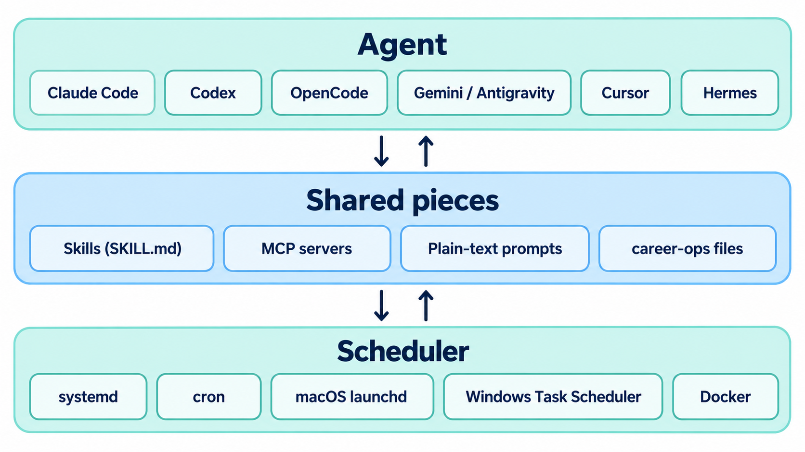

# Run it with any agent, on any system

Nothing here depends on Claude Code or Hermes. They're just what this setup happens to use. The workflow is built from four portable pieces:



| Piece | What it is | Why it's portable |
|---|---|---|
| **Skills** | `SKILL.md` folders (`claude-code/skills/`, `hermes/skills/`) | Plain markdown with a short header. Most agent CLIs now read this format, and any agent can follow it if you paste or reference the file. |
| **MCP servers** | Tsenta, the LinkedIn MCP (`linkedin-mcp/`), TinyFish | MCP is an open protocol. Every agent below can connect to an HTTP MCP server. |
| **Prompts** | `hermes/cron/recruiter-referral-target.md`, `claude-code/scheduled-tasks/*/SKILL.md`, `automations/jobs/warm-outbound/prompt.md` | Plain text. Any agent that can run headless can run them. |
| **Plain code** | Python and Node scripts, the career-ops files, `automations/bin/notify` | No AI involved. Runs anywhere Python 3 and Node 20+ run. |

## Agents

| Agent | Skills go in | Add an MCP server | Run headless (for schedules) |
|---|---|---|---|
| Claude Code | `~/.claude/skills/<name>/` | `claude mcp add --transport http <name> <url>` | `claude -p "<prompt>"` |
| OpenAI Codex CLI | Reference the `SKILL.md` from `AGENTS.md`, or paste it into the prompt | `[mcp_servers.<name>]` in `~/.codex/config.toml` | `codex exec "<prompt>"` |
| OpenCode | `.opencode/skills/<name>/` | the `mcp` section of `opencode.json` | `opencode run "<prompt>"` |
| Gemini CLI or Antigravity CLI | `.agents/skills/<name>/` | the `mcpServers` section of its `settings.json` | `gemini -p "<prompt>"` or `agy -p "<prompt>"` |
| Cursor | `.cursor/skills/<name>/` | `.cursor/mcp.json` | `cursor-agent -p "<prompt>"` |
| Grok CLI | `.grok/skills/<name>/` | its MCP config | `grok -p "<prompt>"` |
| Hermes Agent | `~/.hermes/skills/<name>/` | the `mcp_servers` section of `~/.hermes/config.yaml` | `hermes cron` (built-in scheduler) |
| ChatGPT (web or app) | Paste the skill as a project instruction | Settings → Connectors → add a custom MCP connector by URL | Scheduled tasks in ChatGPT |
| n8n | AI Agent node with the prompt | MCP Client node | Schedule Trigger node |

career-ops itself already ships skill folders for Claude Code, OpenCode, Codex, Antigravity, Grok, Qwen and Cursor (`.claude/`, `.opencode/`, `.agents/`, `.grok/` and so on). Open your agent inside the career-ops folder and the `/career-ops` command works.

**Fully in the cloud, no server.** This setup started as a ChatGPT scheduled task. Every morning at 09:00 it applied through the Tsenta MCP connector and then sent LinkedIn invites through the LinkedIn MCP connector. The same pattern works in any assistant that supports both scheduled tasks and custom MCP connectors. You lose the systemd jobs (Telegram approvals, the reply poller), but you keep applying and outreach.

### Running a scheduled prompt with a different agent

Every scheduled AI job is just "open the career-ops folder, run this prompt headless, send the output somewhere". For example, the recruiter scout with Codex instead of Hermes:

```bash
# one time: copy the "## Prompt (verbatim, scrubbed)" section of
# hermes/cron/recruiter-referral-target.md into ~/career-ops/recruiter-prompt.md
cd ~/career-ops
codex exec "$(cat recruiter-prompt.md)" \
  | ~/ai-job-search-workflow/automations/bin/notify -t telegram -s "Recruiter scout"
```

Two things to check when you switch agents:
1. **Tool names.** The prompts call MCP tools by short names (`get_invite_budget`, `send_invitation`). Agents prefix them differently (`mcp__linkedin__send_invitation` in Claude Code). Name your MCP server `linkedin` and agents will find them.
2. **Unattended permissions.** A headless run can't stop to ask you. Allow the MCP tools the job needs ahead of time, and nothing else. Claude Code uses `--allowedTools`; Codex uses its approval mode setting. Deny the shell for jobs that only need MCP tools.

## Models

The prompts don't depend on one model family. They were tuned on Claude Sonnet and Opus, and these work too:

| Option | Cost | Notes |
|---|---|---|
| Claude Pro or Max subscription | $20 or $100+ a month | What this setup uses, for both Claude Code and Hermes |
| ChatGPT Plus or Pro (Codex) | $20+ a month | `codex exec` for scheduled jobs |
| Gemini CLI or Antigravity | Free tier | Fine for scoring and drafting |
| OpenRouter free models | $0 | The fallback model for the LinkedIn poller here |
| Local models (Ollama, LM Studio) | $0 | Good for drafting replies. Use a strong model for the 0 to 5 scoring, because weak models inflate scores. See career-ops `docs/RUNNING_ON_A_BUDGET.md`. |

Whatever you pick, keep the fact rule. Smaller models are more likely to invent a skill to make a resume fit.

## Schedulers and operating systems

The server jobs ship as systemd user units (`systemd/`). The same jobs run under any scheduler. Here is the 06:00 apply run four ways.

**Linux, cron** (`crontab -e`):

```cron
0 6 * * * cd $HOME/automations && RUN_JOB_SENDER=notify NOTIFY_TARGETS=telegram bin/run-job tsenta-0600 telegram -- jobs/tsenta-nightly/run.sh 0600
```

**macOS, launchd** (`~/Library/LaunchAgents/com.jobsearch.tsenta-0600.plist`, then `launchctl load` it):

```xml
<?xml version="1.0" encoding="UTF-8"?>
<!DOCTYPE plist PUBLIC "-//Apple//DTD PLIST 1.0//EN" "http://www.apple.com/DTDs/PropertyList-1.0.dtd">
<plist version="1.0"><dict>
  <key>Label</key><string>com.jobsearch.tsenta-0600</string>
  <key>ProgramArguments</key><array>
    <string>/bin/bash</string><string>-lc</string>
    <string>cd ~/automations &amp;&amp; RUN_JOB_SENDER=notify bin/run-job tsenta-0600 telegram -- jobs/tsenta-nightly/run.sh 0600</string>
  </array>
  <key>StartCalendarInterval</key><dict><key>Hour</key><integer>6</integer><key>Minute</key><integer>0</integer></dict>
</dict></plist>
```

**Windows, Task Scheduler.** The jobs are bash scripts, so run them through WSL:

```powershell
schtasks /Create /SC DAILY /ST 06:00 /TN "jobsearch-tsenta-0600" /TR "wsl.exe -e bash -lc 'cd ~/automations && RUN_JOB_SENDER=notify bin/run-job tsenta-0600 telegram -- jobs/tsenta-nightly/run.sh 0600'"
```

**Docker.** Run the server half in one container with a cron daemon (for example `supercronic`) and the crontab above. Mount the career-ops folder and the `.env` files as volumes, and keep the container running.

| systemd feature these jobs rely on | Replacement elsewhere |
|---|---|
| `RandomizedDelaySec` (jitter) | `sleep $((RANDOM % 60))` before the command |
| `OnFailure=job-failed@` | `run-job` already alerts when the job exits non-zero |
| `RuntimeMaxSec` caps | `timeout 270m <command>` |
| `flock` single-run lock | Already inside the job script, works on any Unix |
| Lingering user services | A server that stays logged in, or a system crontab |

## Minimum to get value

You don't need all of it:

1. **Only an agent and career-ops:** paste job links and get scores, tailored resumes and answers. You apply by hand. Cost: your agent subscription.
2. **Add the Tsenta MCP:** your agent applies for you, with you watching. Run the `tsenta-daily` skill each morning.
3. **Add a scheduler, `run.sh` and `notify`:** applies happen while you sleep, and a summary lands on your phone.
4. **Add Unipile and the LinkedIn MCP:** recruiter invites and the reply loop.
