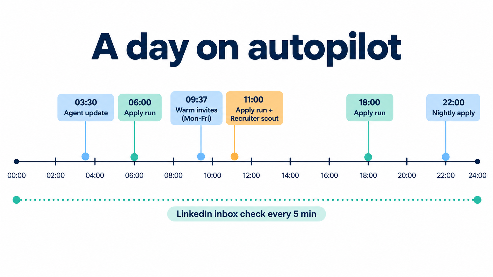
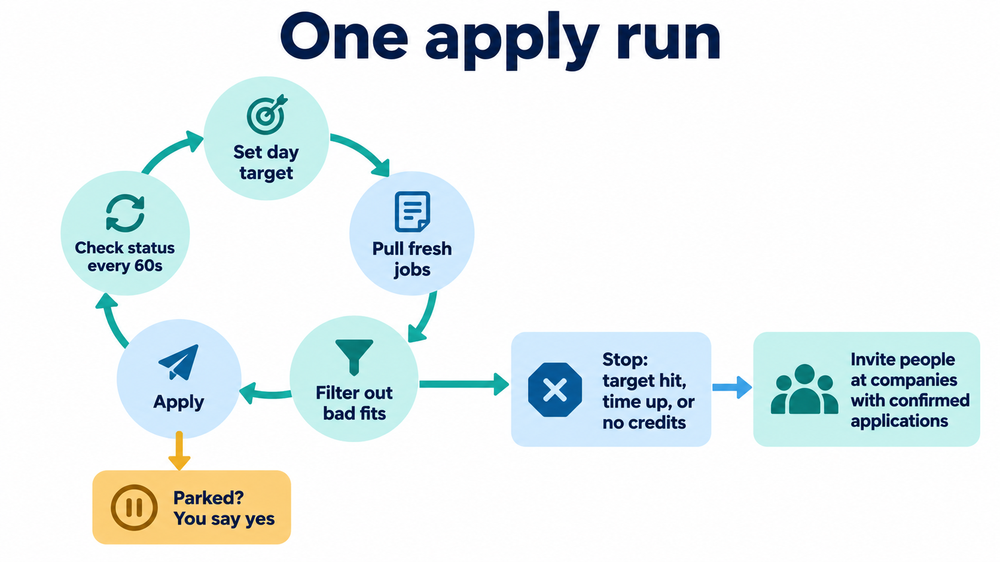
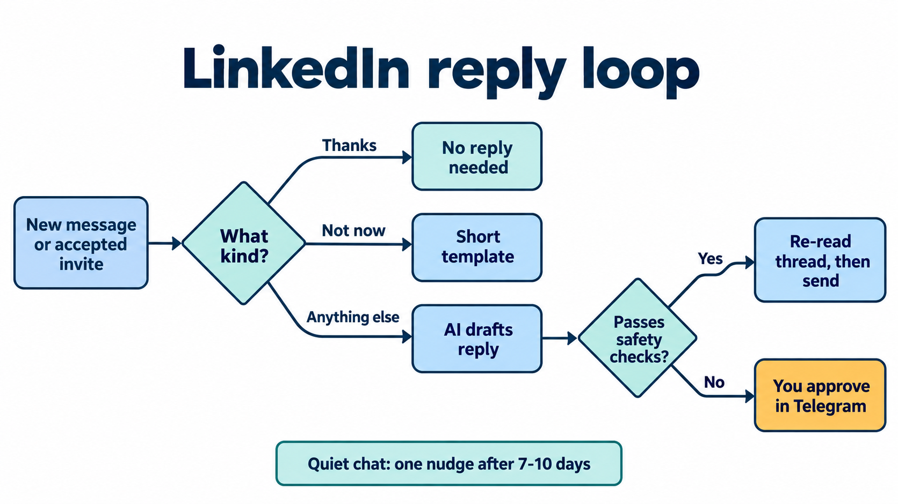
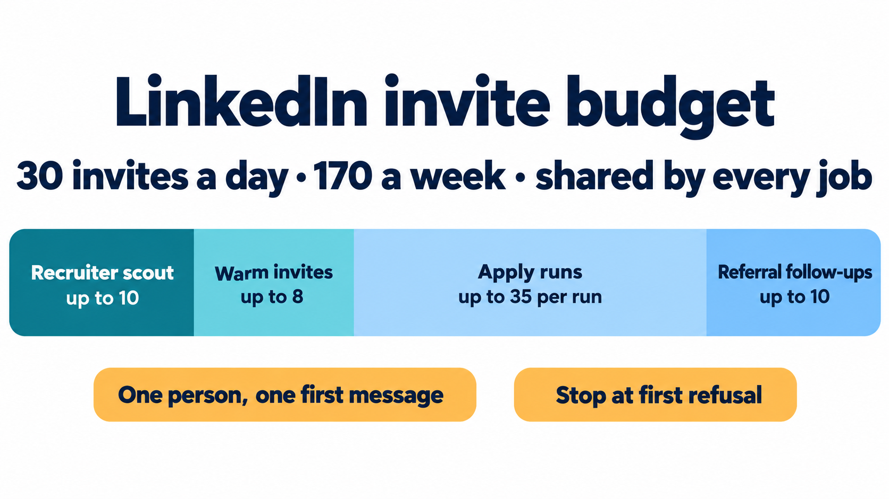
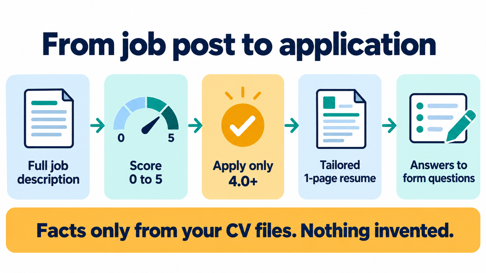

# How it works

The workflow has two halves:
- **Home server (Linux):** does the daily work unattended. That means plain systemd timers for anything that needs no thinking, and one Hermes cron for the part that does.
- **Workstation (Windows):** runs Claude Code for the hands-on parts, such as tailoring a resume for one job or answering an application form.

Both halves read and write the same career-ops repo, which is synced between the machines.

## The rules every agent follows

These sit at the top of every prompt and skill (`career-ops/modes/_custom.md`, `career-ops/modes/_profile.template.md`):

1. **One source of truth.** Resumes, answers, reports and messages may only use facts from four files: `cv.md` (or `cv-aiml.md`), `article-digest.md`, `config/profile.yml` and `modes/_profile.md`. Keywords can be reordered or reframed, never invented. Employment dates are copied exactly.
2. **Score from the full job description, never from the feed.** Feed metadata is wrong often enough to matter (a Director role was tagged entry level).
3. **Apply only at 4.0 or higher** on a 0 to 5 scale. The honest ceiling is about 4.4. A missing *required* skill is a real deduction. Consulting or staff-augmentation roles rank below product ML roles, and a stub or aggregator posting caps at 3.5. Zero survivors is a valid result; never inflate a score to hit a count.
4. **Hard skips** come before scoring: senior, staff, lead, manager or director titles, interns, non-US roles, and any clause your work authorization can't meet (citizenship, clearance, ITAR or export control, U.S. Person). A plain "no sponsorship" line is a ranking signal, not a reject.
5. **One person, one first message.** Nobody gets both a LinkedIn note and an email unless you decide on a second touch. Every send is checked against the ledger first.
6. **Outreach follows the application.** Invite people only at companies where the application is confirmed `COMPLETED`. Never write "I applied" unless the tracker shows it.
7. **Writing style.** No em dashes, no flattery, no AI-sounding filler. Connection notes are at most 300 characters, and the count is checked. Messages never name your past employers.
8. **Nothing goes out without a decision.** Either you approve it, or it falls under a standing, written rule with a hard cap. Today that covers connection requests, guarded replies and Tsenta applies.

## Server side, one weekday

### Apply runs (06:00, 11:00, 18:00, 22:00)

Each run is `automations/jobs/tsenta-nightly/run.sh`, which calls the Python runner in `career-ops/scripts/run_tsenta_nightly_direct.py` (`systemd/tsenta-slot@.service`, `tsenta-nightly.service`).

1. **Lock.** Take `flock ~/.cache/tsenta-run.lock`. If an earlier run still holds it, wait up to 90 minutes, then skip and post a note to Slack.
2. **Day target.** While a billing cycle is active, the target is `ceil(credits left / days left in the cycle)`, otherwise `min(100, ...)`. Every run that day reuses the same target, so later runs only fill the shortfall.
3. **Loop.**
   - Refresh the candidate pool, at most 3 times.
   - Filter out senior, lead, intern, new-grad and contract titles, citizenship or clearance requirements, defense and federal employers, and off-profile titles.
   - Apply, then poll in-flight applications every 60 seconds.
   - Stop when the target is reached, time runs out, attempts hit 3 times the target, credits run out, the pool is empty, or nothing changes for 30 minutes.
4. **Review gates.** Resume reviews from this run are approved automatically. Applications that Tsenta parks in `PENDING_SUBMIT_REVIEW` are **never** submitted without your "yes".
5. **Outreach.** For this run's `COMPLETED` applications only, find people and send invites. The limit is 35 per run, 10 if the budget can't be read, and none if the budget is used up.
6. **Report.** Post a Slack summary and write `reports/tsenta-nightly-DATE.md`.

Run time limits: 270 minutes at 06:00, 390 at 11:00, 210 at 18:00, and 420 for the nightly run (its unit timeout is 9 hours: 7 for the loop, 1 for outreach and 1 for Slack).

**Recovering from a partial apply.** `apply-to-job` can time out after it has already created some applications, and that trips the MCP circuit breaker. The runner saves `run_started_at_utc` before the first apply and never retries blindly. Instead it waits out the backoff, lists live applications, and treats the rows created at or after that timestamp as the truth. After the first outreach pass it re-lists to catch late completions and runs a second pass that is safe to repeat.

### LinkedIn inbox check (every 5 minutes)

`career-ops/deploy/unipile-poll.mjs` runs from `career-ops-linkedin-poll.timer` every 5 minutes with up to 45 seconds of jitter. When nothing has happened, a check costs 2 API list calls and takes 1 to 2 seconds.

- **"Thanks" or already answered:** do nothing.
- **"Not at this time":** a fixed template, with no model call.
- **Anything else:** an AI draft (at most 5 per check, 175 seconds each).
- **Auto-send** (`LINKEDIN_AUTOSEND=1`): a draft is sent only if it passes the relevance check, a sanity check and `autoreply-guards.mjs`. It also **re-reads the thread first** and skips the send if you already answered or something newer arrived.
- **Held items** go to Telegram with approve, edit, skip and invite buttons. Anything held for more than 24 hours gets one reminder. A conversation that goes quiet gets one nudge after 7 to 10 days.
- **Never answered unattended:** pay, scheduling, ID numbers or work-authorization questions.
- **Limits:** replies have no cap. Follow-up invites are capped at 10 a day plus the shared budget. Each check stops after 25 sends.

### Warm invites (09:37, Monday to Friday)

`automations/jobs/warm-outbound/` runs in two phases.

**Phase 1 (AI, read-only).** Claude Sonnet runs headless (`claude -p`) on the subscription, with a 25-minute limit, at most 60 turns and at most 40 LinkedIn calls.
- It searches AI/ML job postings and reads their hiring teams. About 1 posting in 8 lists one.
- It writes up to twice the day's target as candidates, each with a 20 to 300 character note.

**Phase 2 (plain code, no AI).** For each candidate, it checks:
- The note: no past-employer names, links, contact details or placeholders.
- The profile: not already a 1st-degree connection, the title is recruiter, hiring or founder, and the employer matches.
- That they haven't been contacted before, and that budget is left.

Then it sends.
- The cap is 8 a day, further limited to `min(remaining today - 10 reserved for the recruiter job, floor(remaining this week / 3))`.
- Any global refusal stops the batch.

### Recruiter scout (11:00, Hermes cron)

The only LLM cron. The full prompt is in `hermes/cron/recruiter-referral-target.md`.

1. **Discover.** A web search finds up to 20 named recruiters, each with a LinkedIn URL and evidence. About half come from the best-fit companies and half from small and mid-size AI-native companies with emails that can be verified.
2. **Confirm.** Up to 12 profile lookups, stopping at the first rate limit. Then a budget check; with 0 left, everything is held.
3. **Send.** Up to 10 invites, only to confirmed matches: the employer and recruiter title must match, they are not already connected, and they appear in no ledger or contact file. Notes are at most 300 characters and say "I applied" only if the tracker shows it.
4. **Refusals.** A refusal scoped to one person holds that person and continues. Any other refusal stops the batch.
5. **Wrap up.**
   - Update `contacts.json` and `contact-status.json`.
   - Run `find_recruiter_emails.py`, which only finds and verifies addresses.
   - Check the dashboard and post a Slack report (sent, held, budget left, emails verified).

**Approval model.** A standing written approval covers connection requests only. Messages, InMail and email from this job are not allowed. Recruiter emails are queued and go out only after you reply "approved" in Slack.

### Always on

`linkedin-mcp` serves every agent. `career-ops-assist` serves drafts. The Telegram bot listens and the dashboard renders. If any timer unit fails, an alert goes to Slack, at most once an hour.

## The LinkedIn budget

**Shared limits.** Every job that can send an invite draws from one ledger: **30 invites a day and 170 a week**. These are checked against LinkedIn's own sent-invitations list. Restrictions were seen at about 112 a week, so the weekly cap leaves room only if usage stays spread out.

**Before every send:**
1. `check_contacted`. An unreachable check counts as "unknown", so the invite is held.
2. `get_invite_budget`.
3. Send, labelled with where it came from.

**Throttling.** If a people search returns 0 results for every term, LinkedIn is throttling, not empty. The jobs report it and skip sourcing for the day.

## Workstation side

| Tool | What you do with it |
|---|---|
| `resume-forge` | `/resume-forge <job URL or text>` turns a posting into a one-page ATS-clean PDF in one of three templates (modern HTML, classic HTML, LaTeX). It never invents and stops before submitting. |
| `application-answers` | `#<report number> answer these questions` writes first-person answers to a form's questions from your CV files and the job's report. No em dashes, and dates are copied exactly. |
| `tsenta-daily` | The interactive version of the apply run, for days you want to watch it. |
| `jobspy` | Scrapes LinkedIn, Indeed, Glassdoor, Google and ZipRecruiter into CSV, JSON or XLSX. |
| `linkedin-profile-search` | Logged-out search of public profiles by company and location. |
| `cold-email` | Tone and structure for recruiter emails. |

The Claude Code scheduled scans (`claude-code/scheduled-tasks/`, 04:15 and 14:00) did the apply runs before they moved to the server. They are kept, disabled, as a single-machine option. Use them if you don't have a home server.

**Before any batch counts as done:**
- `node verify-pipeline.mjs` reports 0 errors.
- `pdfinfo` shows one page per resume.
- A grep shows exact CV dates.
- No tracker additions are left unmerged.

## Where things are recorded

| What | File |
|---|---|
| Every application and its status | `data/applications.md` (tracker), `data/tsenta-apps.json` (Tsenta mirror) |
| Every invite and message | `data/outreach_log.json` (provider id, invitation id, note) |
| Contacts and their drafts | `data/contacts.json` (connect note, InMail, follow-up), `data/contact-status.json` |
| Per-run reports | `reports/` |
| Dashboard | `career-ops/deploy/outreach-dashboard.mjs` and the career-ops web dashboard |

None of these files are in this repo. They hold real people's data.
