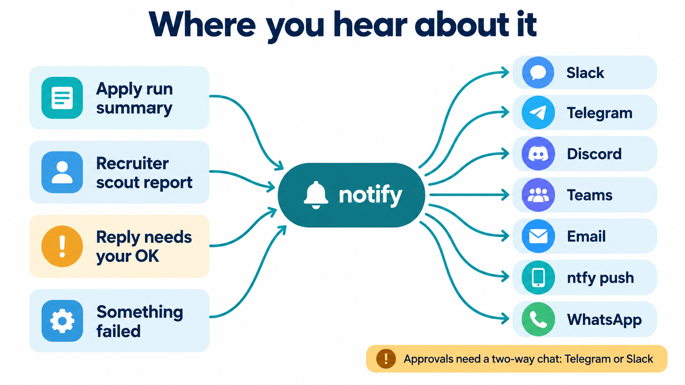

# Notifications: what you hear about, and where

You don't watch this workflow. It messages you. There are two kinds of message:

- **Reports and alerts** only need to reach you, so any one-way channel works: Slack, Telegram, Discord, Teams, Google Chat, email or phone push.
- **Approvals** need you to answer, so they need a two-way chat. This setup uses Telegram for LinkedIn replies and Slack for everything else.



## Every message the workflow sends

| Event | When | Default channel | Needs your answer? |
|---|---|---|---|
| Apply run summary (applied, confirmed, expired, credits left, invites sent) | After each run: 06:00, 11:00, 18:00, 22:00 | Slack | No |
| Application parked for review (`PENDING_SUBMIT_REVIEW`) | Inside the run summary | Slack | **Yes**: reply "yes" to submit |
| Warm-invite summary (sent, held and why) | 09:37, Monday to Friday | Slack | No |
| Recruiter scout report (sent, held, budget left, emails verified) | About 11:05 | Slack | No |
| Recruiter email ready to send | In the scout report | Slack | **Yes**: reply "approved" |
| LinkedIn reply draft held (failed a guard, or auto-send is off) | Within 5 minutes of their message | Telegram | **Yes**: approve, edit, skip or invite buttons |
| Every LinkedIn message actually sent, with its text | When sent | Telegram | No |
| Held reply still waiting after 24 hours | Once | Telegram | Yes |
| A job failed (with the last 20 log lines, secrets removed) | When it happens, at most once an hour per job | Slack | No |
| Nightly agent update failed | About 03:30 or 04:20 | Slack | No |

Quiet days stay quiet: a job that has nothing to say posts nothing.

## How a message gets out

| Sender | Used by | Channels |
|---|---|---|
| `hermes send` (Hermes Agent CLI, no AI call) | `automations/bin/run-job`, `job-failed`, the recruiter cron | Whatever the Hermes gateway has set up: Slack, Telegram and the others it supports |
| `automations/bin/notify` (Python, no dependencies) | The same scripts with `RUN_JOB_SENDER=notify` | Slack, Telegram, Discord, Teams, Google Chat, ntfy, email |
| `career-ops/deploy/telegram-notify.mjs` and `telegram-control.mjs` | The LinkedIn poller and the Telegram bot | Telegram, two-way |

## Switching channels without Hermes

`automations/bin/notify` sends to one channel or several at once. Set the variables for the channels you want, then point the jobs at it:

```bash
# in the job's environment (systemd drop-in, crontab, or a .env the job sources)
RUN_JOB_SENDER=notify
NOTIFY_TARGETS=telegram,email        # used when a job doesn't name a target
```

| Channel | Target name | Set these | How to get them |
|---|---|---|---|
| Slack | `slack` | `SLACK_WEBHOOK_URL` | Slack app → Incoming Webhooks → add to a channel |
| Telegram | `telegram` or `telegram:<chat id>` | `TELEGRAM_BOT_TOKEN`, `TELEGRAM_CHAT_ID` | Create a bot with @BotFather; message it once, then read your chat id from `getUpdates` |
| Discord | `discord` | `DISCORD_WEBHOOK_URL` | Channel settings → Integrations → Webhooks |
| Microsoft Teams | `teams` | `TEAMS_WEBHOOK_URL` | Workflows app → "Post to a channel when a webhook request is received" |
| Google Chat | `gchat` | `GOOGLE_CHAT_WEBHOOK_URL` | Space → Apps & integrations → Webhooks |
| Phone push | `ntfy` or `ntfy:<topic>` | `NTFY_TOPIC`, optional `NTFY_URL`, `NTFY_TOKEN` | Install the ntfy app and subscribe to a hard-to-guess topic, or self-host ntfy |
| Email | `email` or `email:<address>` | `SMTP_HOST`, `SMTP_PORT`, `SMTP_USER`, `SMTP_PASS`, `NOTIFY_EMAIL_FROM`, `NOTIFY_EMAIL_TO` | Any SMTP account; Gmail needs an app password |
| Hermes | `hermes:<platform>:<id>` | Hermes installed and configured | `hermes send -t slack:<channel>` and so on |

Try it before wiring it in:

```bash
echo "hello from the job search" | automations/bin/notify -t telegram -s "Test"
automations/bin/notify --self-test
```

`notify` splits long reports to fit each channel's size limit (Telegram 4,000 characters, Discord 1,900) and tries every target, even if one fails. It exits non-zero if any target failed, so the scheduler records the problem.

**WhatsApp:** there's no simple webhook. Either deliver through a Hermes gateway with WhatsApp set up (`hermes:whatsapp:<id>`), or send through the Unipile API, which can also drive a WhatsApp account. Both are two-way, so they can carry approvals too.

## Approvals on a different chat app

The approval steps are the only part tied to a specific app:

| Approval | Built on | To move it |
|---|---|---|
| LinkedIn reply drafts | The Telegram bot in `career-ops/deploy/telegram-control.mjs` (inline buttons) | Simplest: keep Telegram for this one thing. Otherwise port the button handler to a Discord or Slack bot. The queue and the send code don't change. |
| Recruiter emails, parked applications | A Slack reply read by Hermes ("approved", "yes") | Any two-way agent chat can do it: Hermes on Telegram or WhatsApp, or Claude Code in a chat. The rule lives in the prompt, not in Slack. |

If you only want reports, set `LINKEDIN_AUTOSEND=0` and skip the bots entirely. Every draft then waits in `node linkedin-queue.mjs list --status new` until you handle it in your agent.

## Keep messages safe

- `run-job` and `job-failed` remove bearer tokens, `token=` values, `Authorization` and `X-API-KEY` headers before anything is posted. This is a simple filter, not a full secret scanner.
- The approval bot can send LinkedIn messages as you, so it answers only one chat, `TELEGRAM_ALLOWED_CHAT_ID`, and refuses to start without it. Hermes has its own allow-list, `TELEGRAM_ALLOWED_USERS`. Don't point either one at a group chat.
- An ntfy topic is public to anyone who guesses its name. Use a long random topic or a token.
