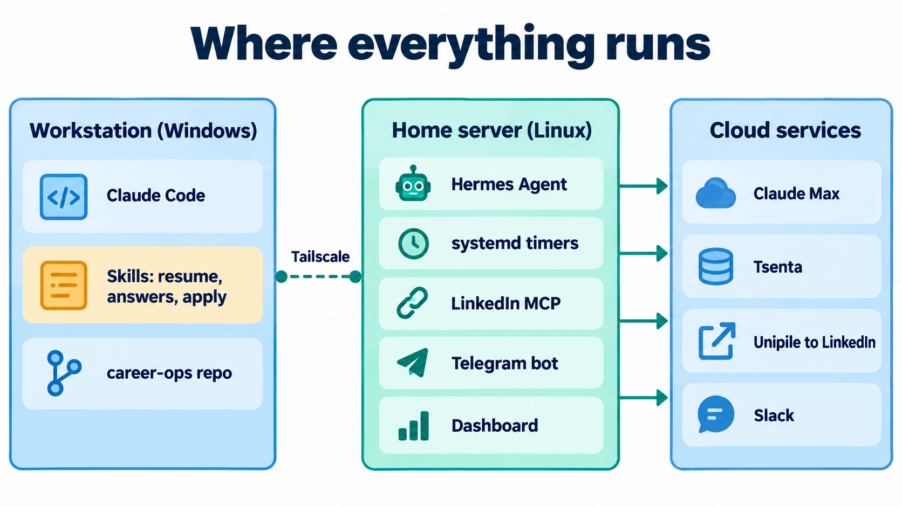

# Setup guide

This guide builds the same setup from scratch. It assumes two machines, but one Linux machine can run everything: see [One machine instead of two](#one-machine-instead-of-two).

It uses Claude Code and Hermes Agent. To use Codex, OpenCode, Gemini, Cursor, ChatGPT or n8n instead, or cron, launchd or Task Scheduler instead of systemd, follow the same steps with the swaps in [any-agent.md](any-agent.md). To get alerts somewhere other than Slack and Telegram, see [notifications.md](notifications.md).

| Machine | Runs | Minimum |
|---|---|---|
| Workstation (Windows, macOS or Linux) | Claude Code for hands-on work: tailored resumes, form answers, scraping | Any laptop |
| Home server (Linux, always on) | Hermes Agent, the LinkedIn MCP server, systemd timers, Telegram bot, dashboard | An old laptop or mini PC with Ubuntu, 8 GB RAM |

Budget about an afternoon for steps 1 to 6, and another for 7 to 10. Each step ends with a check. Don't move on until it passes.



## 1. Accounts

| Service | Plan used | Why | Needed for |
|---|---|---|---|
| [Claude](https://claude.ai) | Max 5x ($100/month) | Claude Code and Hermes both run on the subscription login, so there is no per-token billing | Everything |
| [Tsenta](https://tsenta.com) | Pro, quarterly ($79/quarter) | Submits applications across ATS systems, with a resume optimized per job | Apply runs |
| [Unipile](https://www.unipile.com) | Monthly ($55) | LinkedIn API for invites, messages and lookups | All LinkedIn steps |
| Slack | Free | Run reports, failure alerts, email approvals | Server jobs |
| Telegram | Free | Approve or edit held LinkedIn replies from your phone | Reply loop |
| [Tailscale](https://tailscale.com) | Free | Private network between the two machines | Two-machine setups |

You can start with only Claude and add the rest one at a time. Without Tsenta you apply by hand from the tailored resumes. Without Unipile the outreach drafts still get written, and you send them yourself.

**Check:** you can log in to each account. In Unipile, your LinkedIn account shows as connected.

## 2. Claude Code on the workstation

```bash
npm install -g @anthropic-ai/claude-code
claude auth login          # sign in with the Max account
claude --version
```

**Check:** `claude -p "say ok"` prints `ok`.

## 3. career-ops (the pipeline)

Install the open-source base, then add this repo's custom layer on top.

```bash
git clone https://github.com/santifer/career-ops.git
cd career-ops && npm install
npx playwright install chromium        # PDF generation
npm run doctor                         # checks prerequisites
```

Copy the custom layer from this repo into it:

| From this repo | To career-ops | Notes |
|---|---|---|
| `career-ops/modes/_custom.md` | `modes/_custom.md` | The house rules (scoring calibration, hard skips, outreach rules) |
| `career-ops/modes/_profile.template.md` | `modes/_profile.md` | Fill in your own story, targets and deal-breakers |
| `career-ops/profile.example.yml` | `config/profile.yml` | Replace every `<...>` placeholder |
| `career-ops/*.mjs`, `scripts/`, `lib/`, `assist/`, `config/`, `tests/` | same paths | Scanners, Tsenta runner, outreach code, assist service |
| `career-ops/.claude/workflows/` | `.claude/workflows/` | Multi-agent JD scoring for big batches |
| `career-ops/patches/` | apply with `git apply` | Small changes to upstream files (`.gitignore` and others) |
| `career-ops/.env.example`, `.env.workstation.example` | `.env` | Fill in keys; keep the file at mode 600 |

Then add your own content, which never goes in git:
- `cv.md`: your CV in markdown. This and the next three files are the only source of truth.
- `article-digest.md`: proof points with numbers.
- `portals.yml`: from `templates/portals.example.yml`, with your target companies.

**Check:**
- `node verify-pipeline.mjs` reports 0 errors.
- Pasting a job URL into `claude` inside the folder produces a scored report under `reports/`.

## 4. Claude Code skills and MCP servers

```bash
# skills
cp -r claude-code/skills/* ~/.claude/skills/
cd ~/.claude/skills/resume-forge && npm install    # Playwright for PDFs

# MCP servers (see claude-code/mcp/mcp-servers.example.json)
claude mcp add --transport http tsenta https://api.autojobs.me/api/v1/mcp
claude mcp add --transport http tinyfish https://agent.tinyfish.ai/mcp --header "X-API-Key: <TINYFISH_API_KEY>"
# the linkedin MCP is added in step 6, once it runs on the server
```

Run `/mcp` in Claude Code to sign in to Tsenta (OAuth).

In Tsenta's web app:
- Finish your profile. `get-profile-status` must show nothing under `missingForApplication`.
- Upload a base resume.

**Check:**
- `/resume-forge <any job URL>` writes a one-page PDF.
- In Claude Code, "list my Tsenta applications" returns a list, even an empty one.

## 5. The home server

```bash
# Ubuntu 24.04 or similar
sudo apt install -y git nodejs npm python3-venv
curl -fsSL https://tailscale.com/install.sh | sh && sudo tailscale up
loginctl enable-linger "$USER"          # user services keep running when you log out
```

Sync the career-ops folder between the two machines with Syncthing, or `git` plus a private remote. See `career-ops/deploy/README-deploy.md` for the folders that must be on both: `cv.md`, `config/`, `data/`, `reports/`, `output/` and `portals.yml`.

**Check:** `tailscale status` shows both machines, and the career-ops folder is identical on both.

## 6. LinkedIn MCP server (Unipile)

`linkedin-mcp/` is a small Node server that turns Unipile into 22 MCP tools. It adds three career-ops tools on top: `check_contacted`, `get_invite_budget` and `sync_applications`.

```bash
cd ~/linkedin-mcp && npm install
cp .env.example .env     # UNIPILE_API_BASE, UNIPILE_API_KEY, UNIPILE_ACCOUNT_ID
chmod 600 .env
cp ../systemd/linkedin-mcp.service ~/.config/systemd/user/
systemctl --user daemon-reload && systemctl --user enable --now linkedin-mcp
```

The server listens on port 42834. Reach it over Tailscale, or put a Cloudflare tunnel in front for a public HTTPS URL. On first start it writes a token to `data/mcp-token.txt`, and the URL with that token **is** the credential. Set `LINKEDIN_MCP_READONLY=1` for any client that should only read; the six write tools are then removed entirely.

Add it to Claude Code on the workstation:

```bash
claude mcp add --transport http linkedin "https://<YOUR_LINKEDIN_MCP_HOST>/mcp?token=<TOKEN>"
```

**Check:** in Claude Code, "use get_invite_budget" returns today's and this week's remaining invites.

## 7. Hermes Agent (recruiter cron and Slack front door)

1. Install [Hermes Agent](https://hermes-agent.nousresearch.com/docs/) on the server, following its docs.
2. Run Hermes on your Claude subscription with the [claude-subscription-directsdk plugin](https://github.com/NousResearch/hermes-plugin-claude-subscription-directsdk):
   ```bash
   npm install -g @anthropic-ai/claude-code
   claude auth login                          # as the same user the gateway runs as
   hermes config set model.provider claude-subscription-directsdk-experimental
   ```
   Keep `ANTHROPIC_API_KEY` **unset** for this user, or runs bill the API instead of the subscription.
3. Merge `hermes/config.excerpt.yaml` into `~/.hermes/config.yaml`. It sets the model, fallbacks, `context_file_max_chars`, Slack and the MCP servers. Then copy `hermes/skills/*` into `~/.hermes/skills/`.
4. Create a Slack app in Socket Mode and put the bot and app tokens in `~/.hermes/.env`.
5. Install the gateway and the nightly update units, then **restart the gateway**. It only reads its config at startup.
   ```bash
   cp systemd/hermes-gateway.service systemd/nightly-hermes-* ~/.config/systemd/user/
   cp hermes/scripts/nightly-hermes-update.sh ~/.hermes/scripts/
   systemctl --user daemon-reload
   systemctl --user enable --now hermes-gateway nightly-hermes-update.timer nightly-hermes-gateway-restart.timer
   ```
6. Create the recruiter cron from `hermes/cron/recruiter-referral-target.md`: schedule `0 11 * * *`, workdir set to the career-ops folder, delivery `slack:<CHANNEL>`.

**Check:**
- `hermes send -t slack:<CHANNEL> -f - <<< "hello"` posts to Slack.
- `hermes cron list` shows the job.
- For a test run, start `hermes cron run <id>` **detached** (`nohup ... &`). A short timeout kills the run partway.

## 8. Apply runs and warm invites (systemd, no AI in the loop)

```bash
cp -r automations ~/automations
cd ~/automations && bash install.sh        # installs the units below and enables the timers
```

This installs:
- `tsenta-slot@0600/1100/1800.timer`
- `tsenta-nightly.timer` (22:00)
- `warm-outbound.timer` (09:37, Monday to Friday)
- the `job-failed@.service` alert template

Every job posts its output to Slack through `bin/run-job`, which calls `hermes send` and costs no LLM turn. **Without Hermes:** set `RUN_JOB_SENDER=notify` and the channel variables, and the same jobs post through `bin/notify` to Slack, Telegram, Discord, Teams, Google Chat, ntfy or email (see [notifications.md](notifications.md)). Put these in a systemd drop-in so they apply to every job.

See `systemd/README.md` for the full unit table and drop-ins.

**Check:**
- `RUN_JOB_DRY_RUN=1 ~/automations/jobs/tsenta-nightly/run.sh` finishes and prints a summary.
- `WARM_OUTBOUND_DRY_RUN=1 jobs/warm-outbound/run.sh` runs phase 1 for real and phase 2 as a dry run.
- `systemctl --user list-timers` shows all five timers.

## 9. LinkedIn reply loop, Telegram bot and dashboard

```bash
cd career-ops/deploy && npm install
cp .env.example .env && cp .env.server.example .env.server && cp dashboard.env.example dashboard.env
# fill in Unipile, the Telegram bot token from @BotFather, your Telegram user id, and the caps
bash install-systemd.sh     # career-ops-linkedin-poll.timer, career-ops-telegram, career-ops-dashboard, career-ops-assist
```

Start with `LINKEDIN_AUTOSEND=0`. Every draft then waits for you in Telegram. Turn auto-send on only after a week of drafts you would have sent unchanged. The kill switch is the same variable, and the Telegram bot can flip it.

**Check:**
- Send yourself a LinkedIn message from a second account. Within 5 minutes a draft appears in Telegram.
- The dashboard loads at `http://<HOME_SERVER>:<PORT>`.

## 10. Turn things on, one at a time

1. Week 1: apply runs only. Watch the Slack summaries and check `PENDING_SUBMIT_REVIEW` items yourself.
2. Week 2: add the recruiter cron at its default caps.
3. Week 3: add warm invites.
4. After that, consider reply auto-send.

Keep the shared invite budget at 30 a day and 170 a week. If LinkedIn shows a warning, halve both numbers for two weeks.

## One machine instead of two

Run everything on one Linux machine and skip Tailscale and the sync step. Or, with no server at all, use the Claude Code scheduled tasks in `claude-code/scheduled-tasks/` (04:15 and 14:00 apply passes) instead of the systemd units. They do the same apply runs, but only while the workstation is awake.

## Where the secrets go

| Secret | File | Mode |
|---|---|---|
| Unipile key and account id | `linkedin-mcp/.env`, `career-ops/deploy/.env` | 600 |
| LinkedIn MCP token | `linkedin-mcp/data/mcp-token.txt` | 600 |
| Slack bot and app tokens, Telegram token | `~/.hermes/.env`, `career-ops/deploy/.env` | 600 |
| Tsenta | OAuth in Claude Code (`/mcp`) | n/a |
| Claude | `claude auth login` on each machine | n/a |

Never commit any of them. This repo's `.gitignore` blocks `.env` and `data/`.
